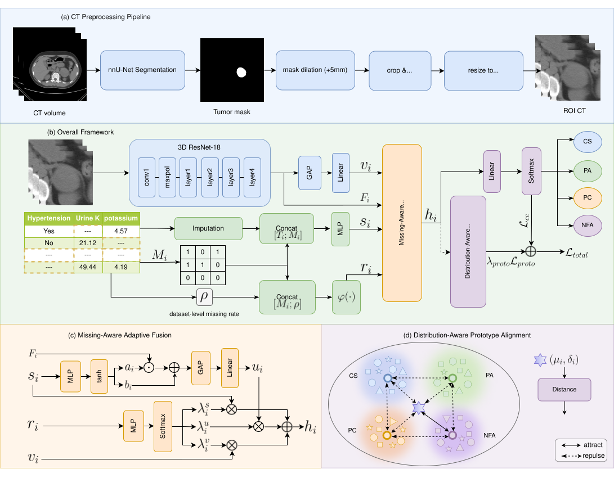

# Missingness-aware Multimodal Learning for Four-class Adrenal Tumor Classification



**AMAF-Net** (Adaptive Missing-Aware Fusion Network) classifies adrenal tumors from **non-contrast CT (NCCT) ROI volumes** and **clinical tabular data**, including a clinical missingness mask. Run commands from this repository root.

The default task is **4-class**: `CS`, `PA`, `PC`, `NFA`. Add `--three-class` to keep only `CS` / `PA` / `PC`.

---

## Quick Start

List experiments:

```bash
python main.py --list-models
```

Full AMAF-Net **with** probabilistic contrastive learning (ProCo), 5-fold:

```bash
python main.py --experiment ours_proco \
  --ct-root /path/to/ct_roi/images \
  --clinical-xlsx /path/to/Adrenal_clinical_EN.xlsx \
  --out-root ./output/amaf_net
```

Same network **without** ProCo (cross-entropy only):

```bash
python main.py --experiment ours \
  --ct-root /path/to/ct_roi/images \
  --clinical-xlsx /path/to/Adrenal_clinical_EN.xlsx \
  --out-root ./output/amaf_net
```

Train **one fold only** (fold 0). The 80/20 case split and the 5-fold partition are unchanged; only the first fold is optimized:

```bash
python main.py --experiment ours \
  --n-folds 1 \
  --ct-root /path/to/ct_roi/images \
  --clinical-xlsx /path/to/Adrenal_clinical_EN.xlsx \
  --out-root ./output/amaf_net_fold0
```

On Windows cmd, after activating the environment and `cd` into this directory:

```bat
python main.py --experiment ours --n-folds 1 --ct-root "D:\path\to\ct_roi\images" --clinical-xlsx "D:\path\to\Adrenal_clinical_EN.xlsx" --out-root ".\output\amaf_net_fold0"
```

### Arguments

- `--experiment`: model name from `--list-models`.
- `--ct-root`: directory of NCCT ROI `.nii.gz` files. Point this at the **image** folder. Do not point it at a parent directory that also contains `tumor_masks`; those segmentations are not model inputs and would be scanned as extra volumes.
- `--clinical-xlsx`: clinical table. Column layout should match `Adrenal_clinical_EN.xlsx`. Not included in this repository.
- `--out-root`: output root. Results are written to `<out-root>/<experiment>/`.
- `--n-folds`: number of folds to train. Default `5`. `1` trains fold 0 only.
- `--three-class`: drop `NFA`.
- `--lambda-proco`: ProCo weight. Default `0.1`. Used only by `ours_proco` and `ours_proco_*`.
- `--proco-temperature`: ProCo temperature. Default `0.07`.
- `--proco-lambda-uncertainty`: uncertainty penalty inside ProCo. Default `0.1`.
- `--no-missing-augmentation`: disable random extra clinical missingness during training.
- `--no-class-balance`: disable minority-class resampling. `ours_proco` already trains without resampling.

There is no separate prediction script. After each fold, the best checkpoint is loaded and the held-out test cases are written to `pred_fold<k>.csv`.

---

## Experiments

| Name | What it trains |
|------|----------------|
| `image_resnet18`, `image_unet3d`, `image_vit` | CT only |
| `clinical_mlp` | imputed clinical values only |
| `clinical_mlp_missing` | clinical values, missing mask, and missing rate |
| `clinical_ft_transformer` | one token per clinical feature |
| `fusion_concat` | 3D ResNet18 + clinical MLP, concatenation |
| `fusion_cross_attn` | bidirectional cross-attention, then concatenation |
| `fusion_daft` | DAFT-conditioned ResNet, two-way missing-aware fusion |
| `fusion_late` | weighted sum of image and clinical logits |
| `fusion_hyperfusion` | DAFT fusion plus a sample-wise hypernetwork head |
| `fusion_drfuse` | shared / modality-specific features with disease-wise attention |
| `ours` | AMAF-Net: three-way FiLM fusion, cross-entropy |
| `ours_proco` | same network as `ours`, plus ProCo on the fused feature |
| `ours_A1` … `ours_E1` | architecture ablations of `ours` |
| `ours_proco_A1` … `ours_proco_E1` | the same ablations with ProCo |

Ablations: **A1** no missing mask, **A2** missing rate only, **A3** fixed fusion weights, **B1** no FiLM interaction, **B2** fixed interaction weight, **C1** no direct clinical branch, **C2** concatenation instead of adaptive fusion, **E1** no pure image branch.

---

## Inputs

Each sample is `(x_ct, C_tilde, R, r_global)`.

- `x_ct`: one-channel NC-phase ROI, shape `96×96×96`. Volumes must already be this size.
- `C_tilde`: numeric clinical features. Missing entries are median-imputed on the training split of each fold, then z-scored.
- `R`: clinical missing mask. `R_j = 1` when feature `j` is empty in the Excel file. This mask is built by the loader; it is not a file you pass on the command line.
- `r_global`: fraction of missing clinical features for that case.

Image filenames should look like `CS_<matched_folder>_NC_0000.nii.gz`. The class prefix is `CS`, `PA`, `PC`, or `NFA`. The middle token must match `matched_folder` in the clinical table (for example `000188111+sunlindi`).

**Required clinical columns (not used as features):** `tumor_type`; `matched_folder` or `case_id`.

**Feature columns** are the remaining numeric columns. Empty cells are missing. In `Adrenal_clinical_EN.xlsx` they include demographics (`sex`, `age`), vitals (`pulse`, `sbp`, `dbp`), history flags, tumor size features, electrolytes, renal and glucose labs, lipids, and 24h urine measurements.

Tumor segmentation files under a `tumor_masks` folder are **not** multiplied into the CT and are **not** a network input. Preprocessing only uses near-zero voxels inside the ROI to normalize intensity.

---

## What a run writes

Under `<out-root>/<experiment>/`:

| File | Content |
|------|---------|
| `models/best_fold<k>_macroF1.pth` | checkpoint with the best validation macro-F1 |
| `pred_fold<k>.csv` | test-set `case_id`, label, prediction, class probabilities, missing rate |
| `confusion_matrix_fold<k>.png`, `roc_fold<k>.png`, `pr_fold<k>.png` | fold plots |
| `modality_dependency_fold<k>.csv` | mean fusion weights overall and per class |

The console reports AUC, macro-F1, accuracy, and balanced accuracy. For `ours_proco`, early stopping patience is 15 epochs and gradients are clipped at 5. Other experiments use patience 10. All runs use AdamW (`lr=1e-4`, `weight_decay=0.1`), batch size 8, at most 100 epochs, and seed `20260115`.

---

## Repository layout

| Path | Role |
|------|------|
| `main.py` | CLI: choose `--experiment` and start training / test evaluation |
| `config.py` | image size, folds, optimizer, early stopping |
| `data/ct_io.py` | scan `.nii.gz`, parse class / case id / phase, normalize NC volumes |
| `data/clinical.py` | read Excel, build missing mask `R`, per-fold impute and scale |
| `data/dataset.py` | returns `(x_ct, C_tilde, R, r_global, label, case_id)` |
| `data/splits.py` | case-level 80/20 split, then stratified folds |
| `models/missing_aware_fusion.py` | AMAF-Net and ablations A1–E1 |
| `models/proco.py` | ProCo variants; forward also returns `f_fusion` |
| `models/daft.py` | DAFT, concatenation, cross-attention, late fusion, HyperFusion, DrFuse |
| `models/registry.py` | experiment name → model |
| `train/trainer.py` | one-fold or five-fold loop, checkpoints, test predictions |
| `utils/losses.py` | focal loss and `ProbabilisticContrastiveLoss` |
| `utils/metrics.py` | AUC, macro-F1, accuracy, ECE, Brier, NLL |

---

## Data and privacy

This code was developed with real patient NCCT and clinical data under ethics approval and confidentiality agreements. **No patient data is distributed with this repository.**

To reproduce or extend the work, prepare CT ROIs and a clinical table locally, and obtain institutional ethics and privacy approval. Do not commit raw CT, clinical Excel files, or any file that could identify patients.
